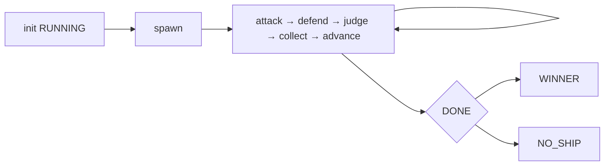
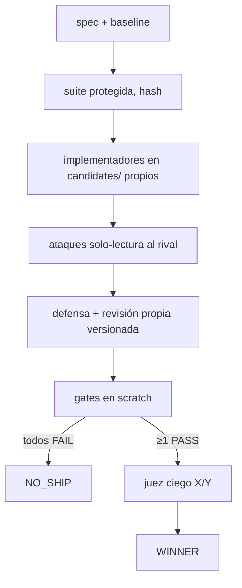

# ⚔️ Arena Forge


**Torneos de ingeniería con evidencia, no con retórica.** N soluciones compiten
con la misma tarea y distintas estrategias, se atacan, se defienden y un juez
ciego decide — pero **los tests mandan**: ningún score supera un gate fallido,
y si nadie pasa, el resultado es `NO_SHIP`, no un campeón forzado.

Metodología derivada de [`Jakeschincariol/arena-skill`](https://github.com/Jakeschincariol/arena-skill)
(MIT, ver `THIRD_PARTY_NOTICES.md`), llevada a código real, aislamiento por
candidato y reanudación total.

> **Estado de la auditoría (2026-10-19): NO-GO.** Hay 2 P0 abiertos (sin frontera de
> sistema operativo; contrato funcional no disponible) y 2 criterios NOT_RUN.
> Ver [`reports/audit/final-audit.md`](reports/audit/final-audit.md).

## Modos

| Modo | Qué compite | Cómo se gana |
|---|---|---|
| **Answer Arena** | Respuestas de texto (N agentes, tarjetas distintas) | Bracket attack → defend → judge con rúbrica congelada |
| **Patch Arena** | Código real en directorios aislados | Gates objetivos (pytest en scratch) + juez ciego X/Y |
| **Benchmark** | El propio sistema | Scheduler determinista + discriminación de la suite |

## Quickstart

```bat
python -m pytest tests/ -q          :: 113 passed
python arena_forge.py plan --agents 4
python arena_forge.py init --mode answer --agents 4 --seed 7 --task "..."
python arena_forge.py next          :: manda la fase; prompts <fase> genera briefs
:: una ola = un tool subagent por job (agent general), en foreground
python arena_forge.py collect && python arena_forge.py advance
python arena_forge.py winner && python arena_forge.py report
```

Patch:

```bat
python arena_forge.py init --mode patch --agents 2 --seed 11 --task "..." ^
  --baseline-dir fixtures/patch-demo/baseline_buggy ^
  --suite fixtures/patch-demo/tests_protected --profile quick
python arena_forge.py gates         :: suite protegida en scratch limpio, SHA antes/después
python arena_forge.py report        :: WINNER solo si gates PASS + juez ciego; persiste decision_id
python arena_forge.py verify        :: revalida suite/baseline/manifiestos/artefacto
python arena_forge.py apply --approve   :: solo escribe reports/*.patch; el proyecto queda intacto
```

> El E2E de Patch **es ASISTIDO**: el runtime escribe briefs, un operador (o el
> orquestador de la skill) lanza las olas de subagentes y coloca el resultado en el
> workspace del candidato. **No hay E2E autónomo.**

## Cómo funciona





- Estado 100% en disco (`.arena/<run>/`): compactación o cierre no pierden nada;
  `resume` continúa sin repetir. `cancel` congela con artefactos.
- Rúbrica Patch congelada por run: funcional 35 · robustez 20 · seguridad 15 ·
  mantenibilidad 10 · rendimiento 10 · documentación 10.
- Coste acotado: `plan` antes de gastar; olas, 1 reintento, timeouts.
  El proveedor no expone tokens por API: se mide en llamadas/olas/tiempo.

## Evidencia real (ejecutada en esta auditoría)

| Caso | Resultado | Artefacto |
|---|---|---|
| Patch E2E (2 candidatos aislados) | `gates` PASS/FAIL → `report` WINNER con `decision_id` → `verify` 11/11 → `apply` → `git apply --check` **exit 0** | [`reports/audit/e2e-patch.md`](reports/audit/e2e-patch.md) |
| NO_SHIP E2E | Ambos FAIL → `NO_SHIP (ningun candidato supera los gates obligatorios)`, sin campeón ni parche | [`reports/audit/e2e-noship.md`](reports/audit/e2e-noship.md) |
| Parche binario | `git diff --binary` real; round-trip **byte-exacto** (texto, binario con/sin NUL, alta, baja, mixto, UTF-8 inválido) | `tests/test_forge.py::BinaryPatchTest` |
| Gate no falsificable | Un candidato con `os._exit(0)` en el import **no** obtiene PASS: el gate exige el informe JUnit | `tests/test_forge.py::GatesTest` |
| Decisión ↔ artefacto | `sha256(parche exportado) == diff_sha` del gate; el parche aplicado reproduce el árbol del candidato | `tests/test_forge.py::ApplyIntegrityTest` |
| Symlinks | Externos, rotos e internos → **fallan** el manifiesto (fail-closed), no se omiten | `tests/test_forge.py::IsolationTest` |
| Seguridad del gate | `PYTHONPATH` = scratch + shim de pytest aislado; `PYTEST_DISABLE_PLUGIN_AUTOLOAD=1`; sin `HOME` del operador; salida acotada en RAM y disco; timeout mata el árbol de procesos | `tests/test_forge.py::GatesTest` |
| Agente E | Aprobación humana **aplicada y ligada**; presupuesto **reservado** bajo lock de SO; `decisions.jsonl` append-only | `tests/test_forge.py::AgentETest` |
| Sondas OpenCode | 5 `verified` (2 de scope `host`), 3 `blocked` (coste), 1 `inconclusive`, 3 `unknown` | `runtime/capabilities.json` |
| Tests | **113 passed**, portables (sin rutas del host), sin ensuciar el repo | [`reports/audit/test-results.json`](reports/audit/test-results.json) |

## ⚠️ Modo de seguridad: `TRUSTED_CODE_ONLY`

Este runtime **no ofrece una frontera de sistema operativo**. No hay Job Object,
AppContainer, usuario de privilegios mínimos, filesystem restringido ni red bloqueada.
El scratch temporal y el entorno filtrado son **higiene, no un sandbox**.

Consecuencia operativa: **ejecuta Arena Forge solo con código en el que confíes.**
Para código no confiable, no ejecutes las gates: usa el modo de inspección y apply
verificado, que no ejecuta el parche del candidato.

El modo se declara en `forge/isolation.py::SECURITY_MODE`, viaja en cada `GateResult`
y se muestra en `verify` y en la salida de `apply`.

## Estructura

```
arena_forge.py          CLI + gobierno (gates, informe, apply, benchmark)
forge/                  isolation · gates · report · integrity · adapter ·
                        agent_e · ledger · contracts · score · state · util
vendor/arena-skill/     bracket.py, strategies.json (2160 cartas), rubric.md, SKILL.md
.opencode/skills/       skill arena-forge (con frontmatter V2)
.opencode/agents/       scout / implementer / reviewer / judge (orden allow-last)
fixtures/               patch-demo (bug + suite protegida) · injection-test
tests/                  113 tests stdlib (scheduler, CLI, gates, escape, NO_SHIP,
                        manifest, diff binario, baseline, E, adapter, portabilidad)
docs/                   RECONNAISSANCE · ARCHITECTURE · THREAT_MODEL · 5 ADRs
reports/audit/          auditoría forense: baseline · findings · matrix · final
.github/workflows/      CI Windows/Linux × Python 3.11/3.12
```

## Licencia

MIT para código propio (`LICENSE`). La metodología y `vendor/` pertenecen a
Jake Schincariol (MIT): atribución, commit y SHA-256 en `THIRD_PARTY_NOTICES.md`.
