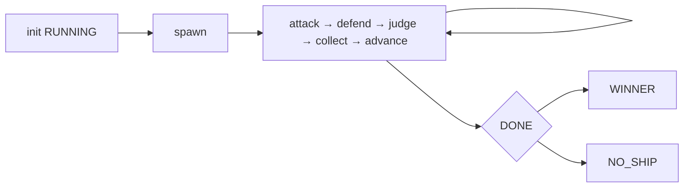
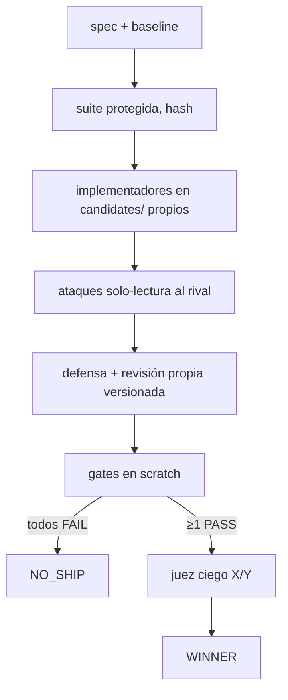

# ⚔️ Arena Forge


**Torneos de ingeniería con evidencia, no con retórica.** N soluciones compiten
con la misma tarea y distintas estrategias, se atacan, se defienden y un juez
ciego decide — pero **los tests mandan**: ningún score supera un gate fallido,
y si nadie pasa, el resultado es `NO_SHIP`, no un campeón forzado.

Metodología derivada de [`Jakeschincariol/arena-skill`](https://github.com/Jakeschincariol/arena-skill)
(MIT, ver `THIRD_PARTY_NOTICES.md`), llevada a código real, aislamiento por
candidato y reanudación total.

## Modos

| Modo | Qué compite | Cómo se gana |
|---|---|---|
| **Answer Arena** | Respuestas de texto (N agentes, tarjetas distintas) | Bracket attack → defend → judge con rúbrica congelada |
| **Patch Arena** | Código real en directorios aislados | Gates objetivos (pytest en scratch) + juez ciego X/Y |
| **Benchmark** | El propio sistema | Scheduler determinista + discriminación de la suite |

## Quickstart (verificado)

```bat
cd arena-forge
python -m pytest tests/ -q          :: 44 passed, ~35 s
python arena_forge.py plan --agents 4
python arena_forge.py init --mode answer --agents 4 --seed 7 --task "..."
python arena_forge.py next          :: manda la fase; prompts <fase> genera briefs
:: una ola = un tool subagent por job (agent general), en foreground
python arena_forge.py collect && python arena_forge.py advance
python arena_forge.py winner && python arena_forge.py report
```

Patch:

```bat
python arena_forge.py init --mode patch --agents 2 --seed 11 --task "..." --suite tests_protected\test_protected.py
python arena_forge.py gates         :: suite protegida en scratch limpio, SHA antes/después
python arena_forge.py report        :: WINNER solo si gates PASS + juez ciego
python arena_forge.py apply --approve   :: solo escribe reports/*.patch; el proyecto queda intacto
```

Skill OpenCode incluida: `.opencode/skills/arena-forge` (`@arena-forge`).

## Cómo funciona





- Estado 100% en disco (`.arena/<run>/`): compactación o cierre no pierden nada;
  `resume` continúa sin repetir. `cancel` congela con artefactos.
- Rúbrica Patch congelada por run: funcional 35 · robustez 20 · seguridad 15 ·
  mantenibilidad 10 · rendimiento 10 · documentación 10.
- Coste acotado: `plan` antes de gastar; olas, 1 reintento, timeouts.
  El proveedor no expone tokens por API: se mide en llamadas/olas/tiempo.

## Evidencia real (no simulada)

| Caso | Resultado |
|---|---|
| Answer E2E, 4 agentes, seed 7 | Campeón **a002** en 2 rondas (23 llamadas: 19 + 4 reintentos por outputs ausentes) |
| Patch E2E, 2 candidatos aislados | Gates PASS/FAIL → WINNER por gates deterministas, juez ciego no requerido (único elegible) |
| NO_SHIP | Candidato buggy FAIL → sin campeón forzado |
| Benchmark | Scheduler OK en n=2,3,4,5,7,8,16 · gates buggy=FAIL/fixed=PASS · suite íntegra |
| Seguridad | README malicioso inerte · `<script>` escapado en informe · oversize en cuarentena · sitecustomize bloqueado |
| Tests | 44/44 PASS (unit + integración + adversarial) |

Informes: [`demo/answer-e2e.md`](demo/answer-e2e.md) ·
[`demo/patch-e2e.md`](demo/patch-e2e.md) · [`demo/no-ship.md`](demo/no-ship.md)

## Estructura

```
arena_forge.py          CLI + gobierno (gates, informe, apply, benchmark)
vendor/arena-skill/     bracket.py, strategies.json (2160 cartas), rubric.md, SKILL.md
.opencode/skills/       skill nativa arena-forge
.opencode/agents/       scout / implementer / reviewer / judge (mínimo privilegio)
fixtures/               patch-demo (bug + suite protegida) · injection-test
tests/                  44 tests stdlib (scheduler, CLI, gates, escape, NO_SHIP, manifest, diff, baseline…)
docs/                   RECONNAISSANCE · ARCHITECTURE · THREAT_MODEL · 5 ADRs
demo/                   3 informes de ejecuciones reales
```

## Licencia

MIT para código propio (`LICENSE`). La metodología y `vendor/` pertenecen a
Jake Schincariol (MIT): atribución, commit y SHA-256 en `THIRD_PARTY_NOTICES.md`.
