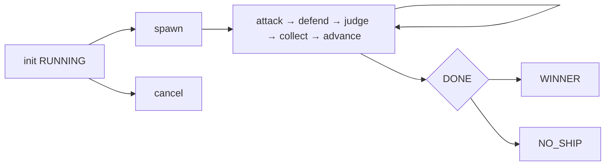
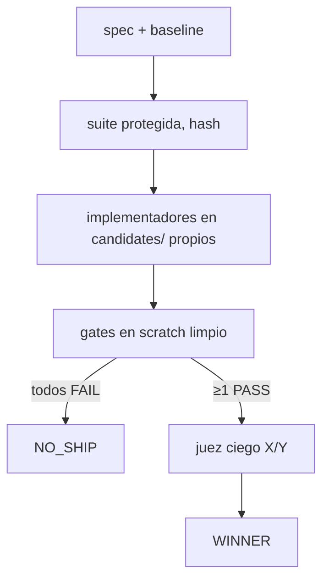

# ARCHITECTURE — Arena Forge

Runtime local (solo stdlib) sobre OpenCode V2. Dos capas: gobierno (`arena_forge.py`,
`forge.json`) y torneo (`vendor/arena-skill/bracket.py`, `arena.json`). El modelo
nunca calcula totales: `decide()` en bracket y `resolve_patch_winner()` aquí.

## Componentes

- `arena_forge.py`: CLI (plan/init/next/prompts/check/pairings/collect/record/
  advance/status/winner/card + gates/resume/cancel/report/benchmark/apply),
  cerradura de controladora, cuarentena de oversize, gates en scratch, informe
  con escape único en frontera.
- `vendor/arena-skill/`: `bracket.py` derivado del upstream (patch OpenCode
  documentado en `THIRD_PARTY_NOTICES.md`), `strategies.json` y `rubric.md`
  idénticos al upstream, `SKILL.md` adaptado a `subagent`/`shell`/`question`.
- `.opencode/skills/arena-forge/SKILL.md`: orquestación nativa OpenCode.
- `.opencode/agents/`: `scout` (read-only), `implementer`, `reviewer`
  (edita solo `.arena/**`, sin shell), `judge` (edita solo `.arena/**`).
- `fixtures/`: `patch-demo` (bug off-by-one + suite protegida),
  `injection-test` (README malicioso inerte).

## Máquina de estados

`forge.json` v1: `{version, mode, status, dir, seed, agents, wave, task_sha,
rubric_sha, cards_sha, suite, suite_sha, baseline_commit, events[]}`.
`status ∈ RUNNING, WINNER, NO_SHIP, CANCELLED, BLOCKED, FAILED`.
`collect/advance` rehúsan en `CANCELLED`. Escritura atómica (tmp+replace).
Lock con stale>300s. `resume` nunca borra: cuenta completados y sigue.

## Flujo Patch

Rúbrica patch (pesos congelados por run): funcional 35, robustez 20,
seguridad 15, mantenibilidad 10, rendimiento 10, documentación 10.
Los gates prevalecen siempre sobre el score.

## Contrato de datos

- Veredictos: `*.verdict.json` ≤1MB (si no, `.oversize` + reintento del juez),
  schema validado por `decide()` (scores 0–10, winner conocido); lo malformado
  queda `.unreadable` y bloquea `advance` hasta re-ejecutar.
- Todo output resuelto debe estar dentro del run (`inside_run`).
- `patch_map.json` liga etiquetas ciegas X/Y a candidatos (fallback: orden).
- Seed fija scheduler/tarjetas/bracket; **no** las salidas del modelo.
