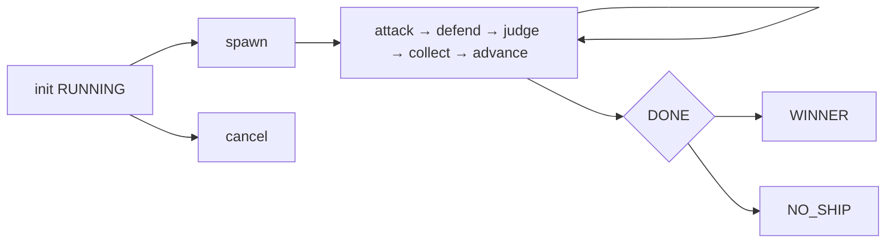
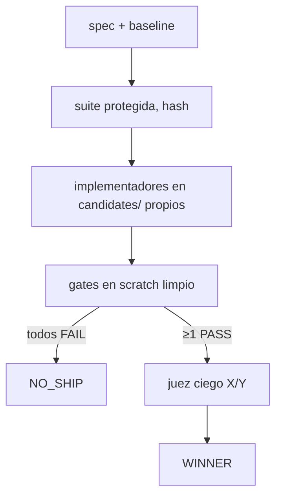

# ARCHITECTURE — Arena Forge

Runtime local (solo stdlib) sobre OpenCode V2. Dos capas: gobierno (`arena_forge.py`,
`forge.json`) y torneo (`vendor/arena-skill/bracket.py`, `arena.json`). El modelo
nunca calcula totales: `decide()` en bracket y **`forge.report.resolve_full()`** aquí
(único motor de decisión: `report`, `verify` y `apply` lo usan).

> Actualizado 2026-10-19 (auditoría forense). `resolve_patch_winner()` —una segunda
> implementación de selección de ganador, que además fabricaba el mapa X/Y desde
> `eligible[0]`— fue **eliminada**.

## Componentes

- `arena_forge.py`: CLI (plan/init/next/prompts/check/pairings/collect/record/
  advance/status/winner/card + gates/resume/cancel/report/apply/verify/decide/
  decisions/isolation/ledger/adapter/bench), cerradura de controladora, cuarentena
  de oversize, gates en scratch, informe con escape único en frontera.
- `forge/`: `isolation` (workspaces, parche canónico, manifiesto) · `gates` (motor
  de gates, entorno mínimo, informe JUnit) · `report` (decisión) · **`integrity`**
  (revalidación de suite/baseline/manifiesto/artefacto) · `adapter` (sondas de
  OpenCode) · `agent_e` (orquestador) · `ledger` · `contracts` · `score` · `state` ·
  `util` (hashing, escritura atómica, lock de SO, redacción).
- `vendor/arena-skill/`: `bracket.py` derivado del upstream (patch OpenCode
  documentado en `THIRD_PARTY_NOTICES.md`), `strategies.json` y `rubric.md`
  idénticos al upstream, `SKILL.md` adaptado a `subagent`/`shell`/`question`.
- `.opencode/skills/arena-forge/SKILL.md`: orquestación nativa OpenCode (con
  frontmatter V2: `name` + `description`).
- `.opencode/agents/`: `scout` (solo lectura), `implementer` (edita
  `.arena/candidates/**` y `.arena/scratch/**`), `reviewer` (edita
  `.arena/artifacts/reviews/**`), `judge` (edita `.arena/artifacts/verdicts/**`).
  En OpenCode V2 gana la **última** regla que coincide: los `deny` amplios van
  primero y los `allow` concretos al final.
- `fixtures/`: `patch-demo` (bug off-by-one + suite protegida),
  `injection-test` (README malicioso inerte).

## Máquina de estados

`forge.json` v2: `{version, schema_version, run_id, mode, status, phase, dir, seed,
agents, wave, task_sha, rubric_sha, cards_sha, suite, suite_sha, baseline_commit,
target_baseline_commit, target_baseline_dir, baseline_manifest,
frozen_baseline_manifest, budget, calls_spent, calls_reserved, candidates{},
approvals[], last_decision, events[]}`.
`status ∈ RUNNING, WINNER, NO_SHIP, CANCELLED, BLOCKED, FAILED`.
`collect/advance`/`gates`/`report`/`apply`/`decide` rehúsan en `CANCELLED`.
Escritura atómica (tmp+replace). Lock de **sistema operativo** (`util.FileLock`,
`msvcrt`/`fcntl`) en el ledger y en la reserva de presupuesto; el lock por run en
`acquire_lock` es un fichero JSON con pid/hora (sin garantía de exclusividad).
`resume` nunca borra: cuenta completados y sigue.

## Flujo Patch

Rúbrica patch (pesos congelados por run): funcional 35, robustez 20,
seguridad 15, mantenibilidad 10, rendimiento 10, documentación 10.
Los gates prevalecen siempre sobre el score.

**Ciclo de decisión verificado byte a byte:**

1. `gates` calcula el manifiesto del candidato y el `diff_sha` del diff
   baseline→candidato; el gate exige el **informe JUnit** de pytest.
2. `report` **recalcula** el diff y la suite viva, revalida el baseline congelado
   y el manifiesto de todos los candidatos, y persiste `decision_id` + `winner_id`.
3. `apply` revalida suite, baseline, manifiesto y diff; comprueba que
   `sha256(parche exportado) == diff_sha` y que el parche aplicado reproduce el
   árbol del candidato; escribe el parche con escritura atómica.

## Contrato de datos

- Veredictos: `*.verdict.json` ≤1MB (si no, `.oversize` + reintento del juez),
  schema validado por `decide()` (scores 0–10, winner conocido); lo malformado
  queda `.unreadable` y bloquea `advance` hasta re-ejecutar.
- Todo output resuelto debe estar dentro del run (`inside_run`).
- `patch_map.json` liga etiquetas ciegas X/Y a candidatos. **No hay fallback**: sin
  mapa no hay desempate y la decisión es `NO_SHIP`.
- Seed fija scheduler/tarjetas/bracket; **no** las salidas del modelo.
